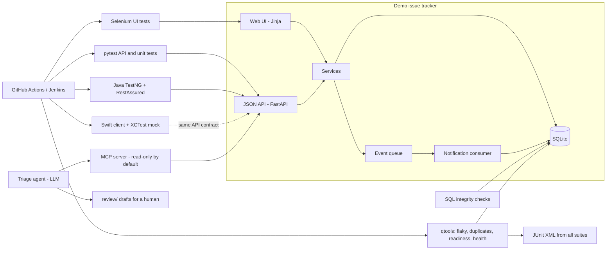

# issue-tracker-quality-lab

A quality-engineering portfolio project. It contains a **small demo issue tracker** (the system under test,
built only for testing practice) and everything a quality engineer would build around it: automated tests in
Python, Java and Swift, browser tests, SQL data checks, command line quality tools, an MCP server, a
human-reviewed AI triage agent, CI/CD and written test documentation.

> All data in this repository is fake (generated with `faker` or written by hand). The tracker has
> **deliberately planted bugs** (see [docs/planted-defects.md](docs/planted-defects.md)); that is the point.

[](https://github.com/Naysrania18/issue-tracker-quality-lab/actions/workflows/ci.yml)

## What is inside

| Area | Folder | Highlights |
|------|--------|------------|
| Demo tracker (system under test) | `app/` | FastAPI + SQLite + Jinja UI, workflow Analyze, Integrate, Build, Verify, Closed, roles, test management, event queue |
| Python tests | `tests/`, `qtools_tests/`, `mcp_tests/` | 210+ tests: parametrized workflow rules, API, events, SQL integrity, strict-xfail for known bugs |
| SQL checks | `sql/` | Five data-integrity queries, [explained](docs/sql-queries.md) |
| Quality tools | `qtools/` | Flaky test detector, duplicate finder (TF-IDF, with precision and recall), release readiness, suite health |
| MCP server | `mcp_server/` | Eight tools, read-only by default, validation, audit log, [setup guide](docs/mcp-setup.md) |
| Agentic testing | `agent/` | Triage agent writes a **draft** bug report, schema-validated, saved for a human; never changes the tracker |
| Browser tests | `ui_tests/` | Selenium, Page Object Model, headless Chrome, explicit waits, screenshots on failure |
| Java API tests | `java-api-tests/` | Maven, TestNG, RestAssured, Allure, data providers; 66 tests |
| Swift client | `swift-client/` | Codable client, CLI, XCTest with mocked networking; runs on Linux |
| CI/CD | `.github/workflows/ci.yml`, `Jenkinsfile` | Five jobs, artifacts, quality gates, [explained](docs/ci-cd.md) |
| Documents | `docs/` | [Strategy](docs/test-strategy.md), [test plan](docs/test-plan.md), [testability review](docs/testability-review.md), [RCA](docs/root-cause-analysis.md), exploratory sessions, [code review example](docs/code-review-example.md), bug reports |

See [docs/skills-map.md](docs/skills-map.md) for a table that maps each skill to the exact files that show it, and
[LEARNING-GUIDE.md](LEARNING-GUIDE.md) for a plain-English walk through every important file.

## Architecture



## Quick start (no Docker)

Requirements: Python 3.10+, Git. Optional: Chrome (Selenium), JDK 17+ and Maven (Java), Swift 5.9+ (Swift).

### Windows (PowerShell)

```powershell
git clone https://github.com/Naysrania18/issue-tracker-quality-lab.git
cd issue-tracker-quality-lab
python -m venv .venv
.venv\Scripts\python -m pip install -r requirements.txt -r requirements-dev.txt

# start the demo tracker with fake data (http://127.0.0.1:8000, API docs at /docs)
.venv\Scripts\python -m app.seed
.venv\Scripts\python -m uvicorn app.main:app
```

### Linux / macOS

```bash
git clone https://github.com/Naysrania18/issue-tracker-quality-lab.git
cd issue-tracker-quality-lab
python3 -m venv .venv
.venv/bin/python -m pip install -r requirements.txt -r requirements-dev.txt

.venv/bin/python -m app.seed
.venv/bin/python -m uvicorn app.main:app
```

Log in at http://127.0.0.1:8000 as `erin` (engineer), `quinn` (QA) or `rita` (reporter). Password: `demo-pass`.

## Running each test suite

Use `.venv\Scripts\python` on Windows and `.venv/bin/python` on Linux. Shown here as `python`.

| Suite | Command | Notes |
|-------|---------|-------|
| Everything in Python (except browser) | `python -m pytest` | About a minute. 6 known-bug tests show as `xfail`, which is expected |
| Smoke only | `python -m pytest -m smoke` | Under 15 seconds |
| With coverage | `python -m pytest --cov=app --cov=qtools --cov=mcp_server --cov=agent` | CI requires 85%+ |
| SQL checks only | `python -m pytest -m sql` | |
| Lint and types | `python -m ruff check .` then `python -m mypy app qtools mcp_server agent` | |
| Selenium | `python -m pytest ui_tests` | Needs Chrome. Starts its own server. Failure screenshots go to `screenshots/` |
| Java API tests | start the tracker, then `cd java-api-tests` and `mvn test` | Override the URL with `-Dtracker.url=http://host:port/api` |
| Java known-defect suite | `mvn test -Dsuite.file=testng-known-defects.xml` | Expected to fail (4 tests) until the bugs are fixed |
| Swift | `cd swift-client` then `swift test` | Mocked networking, no server needed |

## Quality tools (`qtools`)

```
python -m qtools.sample_data                         # regenerate the sample run history
python -m qtools flaky data/junit_runs               # which tests flip between pass and fail?
python -m qtools health data/junit_runs              # slowest, never-failing, failing-without-issue
python -m qtools duplicates "app crashes opening a pdf" --db tracker.db
python -m qtools duplicates-eval                     # precision / recall on the labelled set
python -m qtools readiness --junit-dir data/junit_runs --issues-file data/release_candidate_issues.json --coverage 91
```

### Sample output

Duplicate finder evaluation (`duplicates-eval`):

```
threshold  precision  recall    f1
0.2        0.625      1.0       0.769
0.24       0.769      1.0       0.87
0.26       1.0        1.0       1.0
0.28       1.0        0.9       0.947
0.3        1.0        0.8       0.889
```

The labelled set is tiny (22 issues, 10 duplicate pairs) and the threshold was tuned on it, so treat 1.0 as
optimistic. See [docs/test-plan.md](docs/test-plan.md).

Flaky test report on the sample history:

```
| Test | Runs | Failures | Flips | Score |
| tests.test_sync::test_sync_after_reconnect | 10 | 7 | 6 | 0.67 |
| tests.test_ui::test_attachment_preview     | 10 | 2 | 4 | 0.44 |
| tests.test_sync::test_large_mailbox_sync   | 10 | 5 | 3 | 0.33 |
```

A test that always fails or that broke once and stayed broken is **not** reported as flaky: that is a bug or a
regression, a different problem.

Release readiness (`readiness`) writes `reports/readiness.md` and `readiness.html`. Example of a NO-GO:

```
# Release readiness: NO-GO
## Blockers
- 7 open P1 issue(s): ship-stoppers must be fixed first
- Pass rate 58.3% is below the 95% requirement
- Coverage 70.0% is below the 80% requirement
```

## MCP server and the triage agent

```
set TRACKER_TOKEN=<token from POST /api/auth/login>     (PowerShell: $env:TRACKER_TOKEN="...")
python -m mcp_server                  # read-only
python -m mcp_server --allow-write    # also create_issue and add_comment
python -m agent.triage_agent --title "Sync hangs" --description "..."   # needs ANTHROPIC_API_KEY
```

Connecting it to Claude Desktop or Claude Code: [docs/mcp-setup.md](docs/mcp-setup.md). API keys come from
environment variables only; copy `.env.example` as a guide. All automated tests use a scripted fake model, so
CI needs no key.

## CI/CD

GitHub Actions runs on every push: Python lint, types and tests with a coverage gate; Selenium; Java; Swift;
and a release readiness gate that fails the build on NO-GO. Reports are uploaded as artifacts. The
[Jenkinsfile](Jenkinsfile) has the same stages and runs on any agent with Python, JDK and Chrome.
Details: [docs/ci-cd.md](docs/ci-cd.md).

## What I learned

> TODO (to be written by the repository owner in their own words): three or four things this project taught
> me, what I would do differently, and what I would build next.

## Known limitations

Listed honestly in [KNOWN-ISSUES.md](KNOWN-ISSUES.md). In short: the demo uses SQLite and one process, the duplicate
finder is tuned on a small hand-made dataset, Swift tests run on Linux only, and the Jenkinsfile has not been
run on a real Jenkins server.

## References and credits

All code here is original. These sources shaped the ideas, and I credit them:

- Selenium documentation, [Page object models](https://www.selenium.dev/documentation/test_practices/encouraged/page_object_models/): the page object structure.
- Martin Fowler, [Test Pyramid](https://martinfowler.com/bliki/TestPyramid.html) and Google Testing Blog posts on flaky tests: test levels and the idea of scoring flakiness.
- scikit-learn documentation, [`TfidfVectorizer`](https://scikit-learn.org/stable/modules/generated/sklearn.feature_extraction.text.TfidfVectorizer.html) and cosine similarity: the duplicate finder.
- [Model Context Protocol](https://modelcontextprotocol.io) specification and the official Python SDK: the server design.
- Elisabeth Hendrickson, *Explore It!*, and James Bach's session-based testing: exploratory charters and notes.
- [FastAPI](https://fastapi.tiangolo.com), [pytest](https://docs.pytest.org) (`xfail(strict=True)` pattern), [TestNG](https://testng.org), [REST Assured](https://rest-assured.io), [Allure](https://allurereport.org): tools and their documented practices.

## License

MIT, see [LICENSE](LICENSE).
